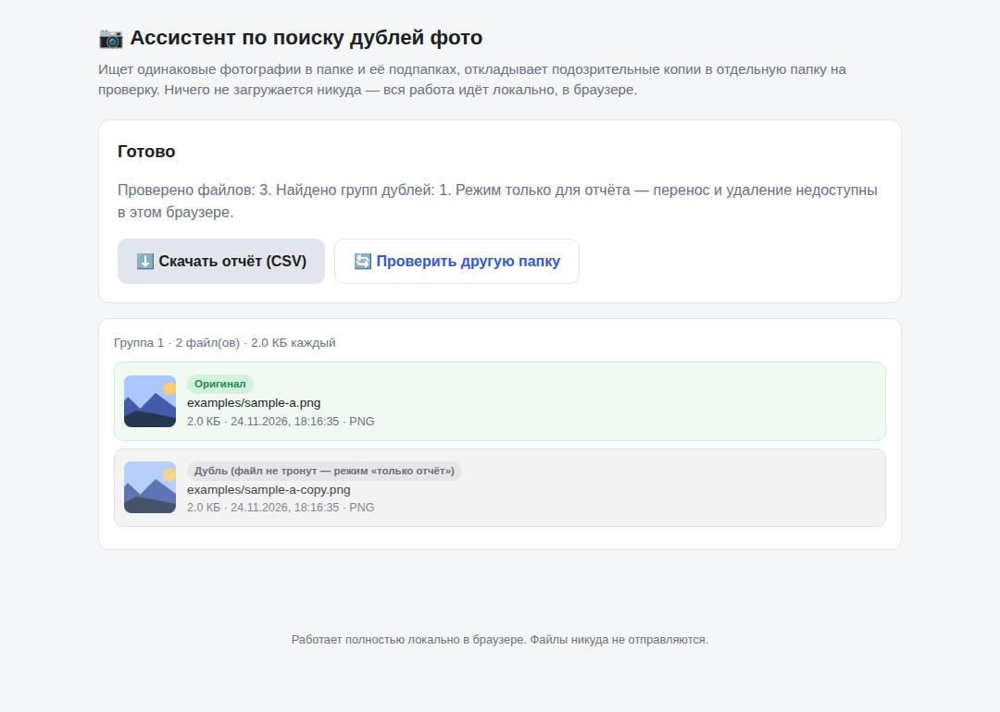

# Photo Dedup Assistant

Браузерное приложение для поиска точных совпадений между фотографиями. Оно проверяет формат файла и сравнивает содержимое по SHA-256. Изображения обрабатываются локально в браузере.



## Быстрый запуск

Из каталога проекта выполните:

```sh
python3 -m http.server 8000 --bind 127.0.0.1
```

Откройте `http://127.0.0.1:8000`. На стартовом экране раскройте **«Мой браузер не поддерживает полный режим»**, нажмите **«Выбрать фото вручную»** и выберите папку `examples`. В ней три вымышленных изображения. Приложение покажет одну группу из двух одинаковых файлов. Нажмите **«Скачать отчёт»**, чтобы получить CSV.

## Возможности

- Обход вложенных папок и поиск совпадений даже при разных именах файлов.
- Сравнение проверяемой папки с эталоном.
- Просмотр результатов без изменения файлов.
- В полном режиме браузер может перенести дубли в папку для проверки и вернуть их обратно. Окончательное удаление требует подтверждения.

Полный режим использует File System Access API и доступен в поддерживаемых браузерах, например Chrome и Edge на компьютере. Для просмотра отчёта подходит ручной выбор.

## Технологии

JavaScript, Web Crypto API, File System Access API, HTML и CSS. Приложение запускается как статический сайт.
